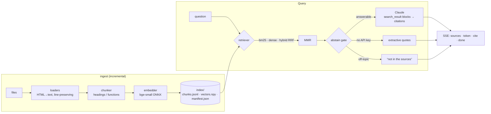

# CiteRAG: ask my projects

A retrieval-augmented question-answering service over my portfolio projects' source code and documentation.
Every claim in an answer links to the exact file and line range it came from, off-topic questions are refused
before any LLM call, and retrieval quality is measured by an evaluation harness and guarded in the test suite.

```
Q: How does the concrete calculator work out the number of labor days?
A: Net volume ÷ (workers × m³ per worker per day), rounded up to whole days [1][2] …
   [1] ConcreteCalc/js/calc.js:32-35   calc.js > calcLaborDays
   [2] ConcreteCalc/README.md:9-20     Concrete Quote Calculator > How the price is calculated
```

**Stack:** Python 3.11+, FastAPI (Server-Sent Events), NumPy, fastembed (local ONNX embeddings), the Claude API
(`claude-opus-5-5` with native `search_result` citations), and a framework-free HTML/JS front end.
No vector database and no LangChain: every stage is small, readable and tested.

## Highlights

- **Grounded citations from the API, not regex.** Retrieved chunks are sent to Claude as `search_result` content
  blocks; Claude returns `search_result_location` citations pointing at a specific chunk, which the UI renders as
  clickable markers that open the source chunk.
- **Structure-aware chunking.** Markdown/HTML headings and code definitions (Python/JS functions, C# classes and
  methods) form section boundaries; chunks keep their heading path (`calc.js > calcLaborDays`,
  `ARAStarPathfinder.cs > ARAStarPathfinder.FindPath`) and **original line numbers**, even for HTML (tags are
  stripped line by line).
- **Three retrievers, chosen by measurement.** BM25 (own implementation, code-aware tokenizer), dense (bge-small,
  local), and hybrid (Reciprocal Rank Fusion), plus MMR to avoid near-duplicate context. The default is set by
  the evaluation below, and the UI lets you switch modes to compare.
- **Abstain gate.** If the question's terms aren't in the retrieved text and semantic similarity is low, the
  service answers "not in the sources" without calling the LLM: cheaper, and it closes the most common
  hallucination path.
- **Incremental indexing.** Files are re-chunked and re-embedded only when their SHA-256 changes; a chunker
  version and the embedder name in the manifest force a rebuild when either changes.
- **Runs without an API key.** Without `ANTHROPIC_API_KEY`, an extractive generator quotes the best-matching
  source sentences with citations, and the UI shows "offline mode". Embeddings run locally, so the whole app
  is free to host. All 64 tests run offline.
- **Multilingual-aware.** Unicode tokenization, Hebrew abbreviation handling (מ״ק) and right-to-left rendering;
  one of the indexed projects is a Hebrew app.

## Quick start

```bash
git clone https://github.com/ElioPikuli/citeRAG.git && cd citeRAG
```

```bash
python3 -m venv .venv && .venv/bin/pip install -e ".[dev]"
```

```bash
.venv/bin/python scripts/fetch_projects.py   # download the indexed projects into ./corpus (~6 MB)
```

```bash
.venv/bin/citerag ingest          # index the corpus listed in citerag.toml (first run downloads a ~70 MB model)
```

```bash
.venv/bin/citerag serve           # http://127.0.0.1:8000
```

With Claude answers instead of offline extracts, set your key first:

```bash
export ANTHROPIC_API_KEY=sk-ant-...
```

Other commands:

```bash
.venv/bin/citerag ask "Which projects use machine learning?"
```

```bash
.venv/bin/citerag search "calcLaborDays" --mode bm25
```

```bash
.venv/bin/citerag eval -v         # retrieval metrics per retriever and per question slice
```

```bash
.venv/bin/pytest
```

`CITERAG_GENERATOR=claude` forces the Claude generator (for example when credentials come from an
`ant auth login` profile rather than an environment variable); `CITERAG_GENERATOR=extractive` forces offline mode.

### What gets indexed

[scripts/fetch_projects.py](scripts/fetch_projects.py) downloads six projects into `./corpus`, all from public
sources: `ConcreteCalc`, `health-monitor-dashboard`, `devops`, `AIVoiceAssistant` and `DynamicLabyrinths` are
shallow-cloned from GitHub (Dynamic Labyrinths is a 1 GB Unity repo, so only its README and C# scripts are checked
out), and the portfolio site's pages are downloaded from the live site. A missing source is skipped with a warning.

To index your own documents, edit `[corpus]` in [citerag.toml](citerag.toml): `sources` (folders or files,
relative to the config file), `include` (extensions or exact file names) and `exclude` (directory or file names).

## Run with Docker / host it for free

The [Dockerfile](Dockerfile) builds everything into the image (corpus, embedding model, index), so the container
starts without downloads and needs no API key:

```bash
docker build -t citerag . && docker run --rm -p 7860:7860 citerag
```

**Free hosting on Hugging Face Spaces** (free CPU tier; the Space sleeps after a while without visitors and
wakes on the next visit):

1. Create a Space at huggingface.co/new-space: SDK **Docker**, hardware **CPU basic (free)**.
2. Upload the two files in [deploy/huggingface/](deploy/huggingface/) (`README.md` and `Dockerfile`) to the Space.
   The Space's Dockerfile clones this repo from GitHub and builds it, so GitHub stays the single source of truth.
3. To publish new commits later, use **Settings → Factory rebuild** on the Space.

The app is then served at `https://<your-username>-<space-name>.hf.space`.

## Architecture



| Module | Role |
|---|---|
| [citerag/loaders.py](citerag/loaders.py) | file discovery, binary/size filters, line-preserving HTML-to-text |
| [citerag/chunking.py](citerag/chunking.py) | sections (headings, code definitions) → paragraphs → size-bounded chunks with overlap |
| [citerag/text.py](citerag/text.py) | tokenizer: camelCase/snake_case splitting, plural folding, Hebrew abbreviations |
| [citerag/bm25.py](citerag/bm25.py) | Okapi BM25 with sparse postings |
| [citerag/embeddings.py](citerag/embeddings.py) | fastembed embedder + deterministic hashing embedder for tests |
| [citerag/store.py](citerag/store.py) | persisted index, atomic save, incremental rebuild |
| [citerag/retriever.py](citerag/retriever.py) | BM25 / dense / RRF hybrid, MMR, per-stage scores |
| [citerag/pipeline.py](citerag/pipeline.py) | retrieve → abstain gate → generate, as one event stream |
| [citerag/generation.py](citerag/generation.py) | Claude generator (streaming, citations, refusal fallback) and extractive generator |
| [citerag/api.py](citerag/api.py), [web/](web/) | FastAPI + SSE, single-page UI with a retrieval inspector |
| [citerag/evaluation.py](citerag/evaluation.py) | Hit@k, Recall@k, MRR, nDCG@k per retriever and per slice; abstain-gate accuracy |

Full design notes and trade-offs: [docs/DESIGN.md](docs/DESIGN.md).

## Evaluation

[eval/golden.jsonl](eval/golden.jsonl) holds 56 hand-written questions: 34 natural-language, 10 that name code
identifiers, 6 in Hebrew, and 6 unanswerable ones. Relevance is judged per file, so the set survives chunking
changes. `citerag eval` on the six-project corpus (78 files, 523 chunks), k = 5:

| questions | retriever | Hit@5 | Recall@5 | MRR | nDCG@5 |
|---|---|---|---|---|---|
| all (50) | bm25 | 0.960 | 0.858 | 0.842 | 0.806 |
| all (50) | dense | 0.980 | 0.872 | 0.878 | 0.831 |
| all (50) | **hybrid** | **0.980** | **0.878** | **0.885** | **0.850** |
| natural (34) | bm25 | 0.941 | 0.836 | 0.825 | 0.783 |
| natural (34) | dense | 1.000 | 0.870 | 0.874 | 0.809 |
| natural (34) | hybrid | 0.971 | 0.865 | 0.868 | 0.831 |
| identifier (10) | bm25 | 1.000 | 0.900 | 0.808 | 0.805 |
| identifier (10) | dense | 0.900 | 0.850 | 0.820 | 0.824 |
| identifier (10) | hybrid | 1.000 | 0.900 | 0.875 | 0.865 |
| hebrew (6) | all three | 1.000 | 0.917 | 1.000 | 0.936 |

Abstain gate: answered 50/50 answerable questions and refused 6/6 unanswerable ones.

**What I learned from it.** I designed the system around hybrid retrieval, expecting BM25 to win on code
identifiers. With only two projects indexed, it didn't: dense retrieval was best or tied on every slice, because
each chunk is embedded together with its heading path (`calc.js > calcLaborDays`), so I shipped `dense` as the
default. Adding four more projects (a Unity game, a DevOps lab, a monitoring dashboard, a voice assistant) changed
the picture: dense and hybrid now tie on Hit@5, and dense starts missing identifier questions (one in ten, e.g.
"What is m3PerWorkerDay?") that hybrid still answers. The more code in the corpus, the more often an exact name
matters, so the default is now `hybrid`. The decision follows the measurements, and the measurements changed with
the corpus.

Caveats, to keep this honest:
- The set is small: one question moves Hit@5 by 2 points, so dense vs. hybrid is still close to noise.
- The abstain thresholds were calibrated on these same questions, so their 100% is optimistic. The margin is thin:
  off-topic questions peak at cosine 0.547 and the weakest answerable one sits at 0.566. A larger corpus also
  produces lexical coincidences: "What's the weather forecast for tomorrow?" matches two thirds of its words
  (the game has weather biomes), which is why the term-coverage threshold is 0.8. The gate leans toward answering,
  because Claude's system prompt is a second line of defense against off-topic questions.
- A larger held-out set is the first thing I'd add.

The eval also caught a corpus problem: indexing this README (which quotes the other projects' identifiers and
example answers) dropped Hit@5 from 1.00 to 0.97 on the two-project corpus, because it competed with the real
sources. It is now excluded from the corpus; [docs/DESIGN.md](docs/DESIGN.md) covers questions about this project.

`tests/test_evaluation.py` fails the build if Hit@5 of the configured retriever drops below 0.95, MRR below 0.85, or the gate starts
answering unanswerable questions.

## Testing

64 tests, all offline, ~3 s: tokenizer, line-preserving HTML conversion, chunk boundaries and line numbers,
BM25 against hand-computed scores, RRF and MMR, index round-trip and incremental rebuilds, the Claude generator
against a fake client (exact request shape: `search_result` blocks, adaptive thinking, effort, refusal fallback;
mapping of `citations_delta` events to chunk indices; refusal and API errors), the abstain gate, the SSE API
(event order, validation, mid-stream failures), and the retrieval regression floor on the real index.
The UI was checked in a browser: streaming, citation markers, the retrieval inspector, abstain, a Hebrew
question with right-to-left rendering, and a 375 px mobile layout.

Not covered: a live call to the Claude API. The request is built to the documented API shape and verified
against a fake client, but the project has been run without an API key; run `citerag ask` with
`ANTHROPIC_API_KEY` set to exercise it.

## Limitations and next steps

- **Bigger, held-out evaluation set**, plus answer-level metrics (citation precision, LLM-as-judge faithfulness)
  once a key is available.
- **Follow-up questions:** each question is retrieved independently; query rewriting from chat history would
  allow "and how is that tested?".
- **Cross-encoder re-ranking** of the top 30 candidates.
- The offline extractive generator is lexical: it won't match "minimum" to `minWorkers`. It is a fallback, not
  the product.
- Single-process, in-memory index: right for thousands of chunks; a vector store would sit behind the same
  `Index` interface for millions.
