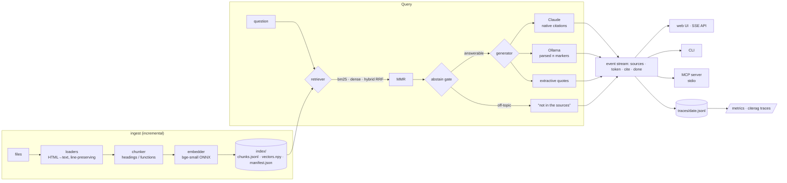

# CiteRAG: ask my projects

A retrieval-augmented question-answering service over my portfolio projects' source code and documentation.
Every claim in an answer links to the exact file and line range it came from, off-topic questions are refused
before any LLM call, and retrieval quality is measured by an evaluation harness and guarded in the test suite.

```
Q: How does the concrete calculator work out the number of labor days?
A: Net volume ÷ (workers × m³ per worker per day), rounded up to whole days [1][2] …
   [1] ConcreteCalc/js/calc.js:32-35   calc.js > calcLaborDays
   [2] ConcreteCalc/README.md:9-20     Concrete Quote Calculator > How the price is calculated
```

**Stack:** Python 3.11+, FastAPI (Server-Sent Events), NumPy, fastembed (local ONNX embeddings), the Claude API
(`claude-opus-5-5` with native `search_result` citations), and a framework-free HTML/JS front end.
No vector database and no LangChain: every stage is small, readable and tested.

## Highlights

- **Grounded citations from the API, not regex.** Retrieved chunks are sent to Claude as `search_result` content
  blocks; Claude returns `search_result_location` citations pointing at a specific chunk, which the UI renders as
  clickable markers that open the source chunk.
- **Structure-aware chunking.** Markdown/HTML headings and code definitions (Python/JS functions, C# classes and
  methods) form section boundaries; chunks keep their heading path (`calc.js > calcLaborDays`,
  `ARAStarPathfinder.cs > ARAStarPathfinder.FindPath`) and **original line numbers**, even for HTML (tags are
  stripped line by line).
- **Three retrievers, chosen by measurement.** BM25 (own implementation, code-aware tokenizer), dense (bge-small,
  local), and hybrid (Reciprocal Rank Fusion), plus MMR to avoid near-duplicate context. The default is set by
  the evaluation below, and the UI lets you switch modes to compare.
- **Abstain gate.** If the question's terms aren't in the retrieved text and semantic similarity is low, the
  service answers "not in the sources" without calling the LLM: cheaper, and it closes the most common
  hallucination path.
- **Incremental indexing.** Files are re-chunked and re-embedded only when their SHA-256 changes; a chunker
  version and the embedder name in the manifest force a rebuild when either changes.
- **Runs without an API key.** Without `ANTHROPIC_API_KEY`, an extractive generator quotes the best-matching
  source sentences with citations, and the UI shows "offline mode". Embeddings run locally, so the whole app
  is free to host. A local model through Ollama is a third option, with citations parsed from `[n]` markers.
- **Answers are measured, not only retrieval.** `citerag eval-answers` reports citation coverage and precision,
  invalid markers and latency, and a local LLM judge scores faithfulness per cited claim. The judge is checked
  against hand-written bad answers first. Everything runs free on a laptop.
- **Observable.** Every request leaves a JSON trace (per-stage latency, tokens, estimated cost, errors);
  `/metrics`, `citerag traces` and a UI panel summarise them.
- **Usable from other AI tools.** An MCP server lets Claude Desktop, Claude Code or Cursor search the index, read
  exact source lines and get cited answers.
- **Tested and gated in CI.** 310 offline tests; GitHub Actions rebuilds the index and fails the build if hybrid
  Hit@5 drops below 0.95 or the abstain gate makes a wrong call.
- **Multilingual-aware.** Unicode tokenization, Hebrew abbreviation handling (מ״ק) and right-to-left rendering;
  one of the indexed projects is a Hebrew app.

## Quick start

```bash
git clone https://github.com/ElioPikuli/citeRAG.git && cd citeRAG
```

```bash
python3 -m venv .venv && .venv/bin/pip install -e ".[dev]"
```

```bash
.venv/bin/python scripts/fetch_projects.py   # download the indexed projects into ./corpus (~6 MB)
```

```bash
.venv/bin/citerag ingest          # index the corpus listed in citerag.toml (first run downloads a ~70 MB model)
```

```bash
.venv/bin/citerag serve           # http://127.0.0.1:8000
```

With Claude answers instead of offline extracts, set your key first:

```bash
export ANTHROPIC_API_KEY=sk-ant-...
```

Other commands:

```bash
.venv/bin/citerag ask "Which projects use machine learning?"
```

```bash
.venv/bin/citerag search "calcLaborDays" --mode bm25
```

```bash
.venv/bin/citerag eval -v         # retrieval metrics per retriever and per question slice
```

```bash
.venv/bin/pytest
```

`CITERAG_GENERATOR=claude` forces the Claude generator (for example when credentials come from an
`ant auth login` profile rather than an environment variable); `CITERAG_GENERATOR=extractive` forces offline mode.

### What gets indexed

[scripts/fetch_projects.py](scripts/fetch_projects.py) downloads six projects into `./corpus`, all from public
sources: `ConcreteCalc`, `health-monitor-dashboard`, `devops`, `AIVoiceAssistant` and `DynamicLabyrinths` are
shallow-cloned from GitHub (Dynamic Labyrinths is a 1 GB Unity repo, so only its README and C# scripts are checked
out), and the portfolio site's pages are downloaded from the live site. A missing source is skipped with a warning.

To index your own documents, edit `[corpus]` in [citerag.toml](citerag.toml): `sources` (folders or files,
relative to the config file), `include` (extensions or exact file names) and `exclude` (directory or file names).

### Local answers with Ollama (free)

Any instruction-tuned model served by [Ollama](https://ollama.com) can write the answers. The model is set by
`ollama_model` in `[generation]`; `qwen2.5:3b` (about 2 GB) runs on a 16 GB MacBook Air M1.

```bash
ollama pull qwen2.5:3b
```

```bash
CITERAG_GENERATOR=ollama .venv/bin/citerag ask "How does ConcreteCalc compute labor days?"
```

Ollama has no citation API, so the chunks are sent as numbered `<source>` blocks and the model writes `[n]`
markers, which are parsed back into citations. Markers that point to a source that wasn't retrieved are dropped
and counted. Small models need firm prompting to cite at all; see "Answer quality" below for what that took and
how well it works. If Ollama isn't running, the answer is a one-line error telling you to run `ollama serve`.

### Traces and metrics

Every `/api/ask` and `/api/search` request, and every `citerag ask` and `citerag search`, appends one JSON line to
`traces/{date}.jsonl`. Each line records:
- the question, cut to 300 characters
- the retrieval mode and the top hits with their scores
- the abstain-gate decision
- the generator and model
- tokens used
- the time spent retrieving, gating and generating, plus the total
- an estimated cost
- the citation and invalid-marker counts
- the error type, if the request failed

To see a summary of recent requests:

```bash
.venv/bin/citerag traces --last 200
```

The summary covers abstain, error and cancel rates, p50/p95 latency per stage for answers (searches are reported
separately), citations per answer, tokens and the total estimated cost. `GET /metrics` returns the same summary as
JSON, and the web UI shows it in a Metrics panel.

- **Cost** is estimated from a `[pricing]` table in [citerag.toml](citerag.toml) (Anthropic list prices, USD per
  million tokens). Ollama, extractive answers, searches and abstentions cost $0. A Claude model missing from the
  table is recorded as `null` and counted as "unknown", never as $0.
- **Tracing never breaks a request:** if a trace can't be written, a warning is logged and the answer still
  streams.
- **Privacy and limits:** `/metrics` returns aggregates only, never question text. Trace files hold visitors'
  questions, so they are gitignored and kept out of the Docker image. They are capped at 50 MB a day and deleted
  after 14 days (`[tracing]` in citerag.toml). `CITERAG_TRACING=0` turns tracing off. On Render's free tier the
  disk is wiped on every deploy or spin-down, so the hosted demo's metrics only cover requests since it last woke.

### Use it from Claude Desktop / Claude Code (MCP)

`citerag mcp` serves the index over stdio as a [Model Context Protocol](https://modelcontextprotocol.io) server,
so Claude Desktop, Claude Code or Cursor can search your projects and cite them. It uses the official MCP SDK, an
optional extra:

```bash
.venv/bin/pip install -e ".[mcp]"
```

Three tools, all read-only:

| Tool | What it returns | Model call? |
|---|---|---|
| `search_sources(query, k=5, mode="hybrid")` | ranked chunks with file, line range, heading path, score and text | none: free, no API key |
| `get_chunk(file, start_line, end_line)` | the exact text of those lines (at most 400), as indexed, so line numbers match citations | none: free, no API key |
| `ask(question)` | an answer with inline `[n]` markers, a matching citation list, and the answer split into cited segments | the chosen generator: extractive by default, local Ollama if configured |

With `search_sources` and `get_chunk`, your client model does the reasoning and citeRAG only retrieves, so it needs
no API key and costs nothing extra. `get_chunk` only reads files that are in the index and inside their source
folder: `../`, absolute paths and symlinks pointing outside are rejected. Errors come back as structured data
(`{"error": {"code", "message"}}`) with the tool error flag set, never as a traceback. Every call is traced with
`source: "mcp"`.

**Claude Code** (replace the paths with your clone's absolute path):

```bash
claude mcp add citerag -- /ABSOLUTE/PATH/citeRAG/.venv/bin/citerag --config /ABSOLUTE/PATH/citeRAG/citerag.toml mcp
```

**Claude Desktop** (`claude_desktop_config.json`; Cursor's `mcp.json` uses the same shape):

```json
{
  "mcpServers": {
    "citerag": {
      "command": "/ABSOLUTE/PATH/citeRAG/.venv/bin/citerag",
      "args": ["--config", "/ABSOLUTE/PATH/citeRAG/citerag.toml", "mcp"]
    }
  }
}
```

No `cwd` is needed: every path in citerag.toml resolves relative to the config file, and I tested the server
launched from an unrelated directory. Run `citerag ingest` first.

`ask` answers with the extractive generator unless you choose another one. To use a local model, add
`"env": {"CITERAG_GENERATOR": "ollama"}` and keep Ollama running. Unlike `citerag serve`, the MCP server never
switches to Claude just because `ANTHROPIC_API_KEY` happens to be in its environment: a client may auto-approve
read-only tools, so a paid `ask` needs `CITERAG_GENERATOR=claude` or `provider = "claude"`. The server prints the
generator it chose to stderr at startup.

## Run with Docker / host it for free

The [Dockerfile](Dockerfile) builds everything into the image (corpus, embedding model, index), so the container
starts without downloads and needs no API key:

```bash
docker build -t citerag . && docker run --rm -p 7860:7860 citerag
```

The host builds and runs the image on its own servers; nothing needs to stay running on your machine.

**Free hosting on Render** (the live demo):

1. In the Render dashboard: **New → Blueprint**, pick this repository. [render.yaml](render.yaml) defines a free
   Docker web service with a health check.
2. Render builds the image and serves it at `https://citerag.onrender.com` (or similar). Every push to `main`
   redeploys automatically.

Tested locally at Render's free-tier limits (`docker run -m 512m --cpus 0.1`): about 180 MB peak memory, ready
in ~30 s, ~0.6 s per question after a ~2.5 s first one. Free services sleep after 15 minutes without traffic,
so the first visit after that waits 30-60 s while it wakes.

**Fallback: Hugging Face Spaces** (more CPU and memory for free, sleeps after 48 h, but rebuilds are manual):

1. Create a Space at huggingface.co/new-space: SDK **Docker**, hardware **CPU basic (free)**.
2. Upload the two files in [deploy/huggingface/](deploy/huggingface/) (`README.md` and `Dockerfile`) to the Space.
   The Space's Dockerfile clones this repo from GitHub and builds it.
3. To publish new commits later, use **Settings → Factory rebuild** on the Space.

## Architecture



| Module | Role |
|---|---|
| [citerag/loaders.py](citerag/loaders.py) | file discovery, binary/size filters, line-preserving HTML-to-text |
| [citerag/chunking.py](citerag/chunking.py) | sections (headings, code definitions) → paragraphs → size-bounded chunks with overlap |
| [citerag/text.py](citerag/text.py) | tokenizer: camelCase/snake_case splitting, plural folding, Hebrew abbreviations |
| [citerag/bm25.py](citerag/bm25.py) | Okapi BM25 with sparse postings |
| [citerag/embeddings.py](citerag/embeddings.py) | fastembed embedder + deterministic hashing embedder for tests |
| [citerag/store.py](citerag/store.py) | persisted index, atomic save, incremental rebuild |
| [citerag/retriever.py](citerag/retriever.py) | BM25 / dense / RRF hybrid, MMR, per-stage scores |
| [citerag/pipeline.py](citerag/pipeline.py) | retrieve → abstain gate → generate, as one event stream |
| [citerag/generation.py](citerag/generation.py) | Claude generator (streaming, citations, refusal fallback), Ollama generator with `[n]` marker parsing, extractive generator |
| [citerag/api.py](citerag/api.py), [web/](web/) | FastAPI + SSE, single-page UI with a retrieval inspector |
| [citerag/evaluation.py](citerag/evaluation.py) | Hit@k, Recall@k, MRR, nDCG@k per retriever and per slice; abstain-gate accuracy |
| [citerag/answer_eval.py](citerag/answer_eval.py), [judge_prompts.py](citerag/judge_prompts.py) | answer quality: citation metrics, local LLM judge (faithfulness, relevance), judge sanity check |
| [citerag/tracing.py](citerag/tracing.py) | per-request traces, cost estimates, `/metrics` and `citerag traces` aggregates |
| [citerag/mcp_server.py](citerag/mcp_server.py) | MCP server: `search_sources`, `get_chunk`, `ask` |
| [.github/workflows/ci.yml](.github/workflows/ci.yml) | tests + retrieval quality gate on every push, no API keys |

Full design notes and trade-offs: [docs/DESIGN.md](docs/DESIGN.md).

## Evaluation

[eval/golden.jsonl](eval/golden.jsonl) holds 56 hand-written questions: 34 natural-language, 10 that name code
identifiers, 6 in Hebrew, and 6 unanswerable ones. Relevance is judged per file, so the set survives chunking
changes. `citerag eval` on the six-project corpus (78 files, 530 chunks, fetched 2026-11-15), k = 5:

| questions | retriever | Hit@5 | Recall@5 | MRR | nDCG@5 |
|---|---|---|---|---|---|
| all (50) | bm25 | 0.960 | 0.858 | 0.816 | 0.786 |
| all (50) | dense | 0.980 | 0.877 | 0.878 | 0.832 |
| all (50) | **hybrid** | **0.980** | **0.878** | **0.885** | **0.851** |
| natural (34) | bm25 | 0.941 | 0.836 | 0.785 | 0.754 |
| natural (34) | dense | 1.000 | 0.877 | 0.874 | 0.816 |
| natural (34) | hybrid | 0.971 | 0.865 | 0.868 | 0.832 |
| identifier (10) | bm25 | 1.000 | 0.900 | 0.808 | 0.805 |
| identifier (10) | dense | 0.900 | 0.850 | 0.820 | 0.824 |
| identifier (10) | hybrid | 1.000 | 0.900 | 0.875 | 0.865 |
| hebrew (6) | all three | 1.000 | 0.917 | 1.000 | 0.936 |

Abstain gate: answered 50/50 answerable questions and refused 6/6 unanswerable ones. The projects are fetched at
their latest versions, so these numbers drift slightly as they change; CI re-runs this eval on every push and
fails below Hit@5 0.95 or on any wrong gate decision.

**What I learned from it.** I designed the system around hybrid retrieval, expecting BM25 to win on code
identifiers. With only two projects indexed, it didn't: dense retrieval was best or tied on every slice, because
each chunk is embedded together with its heading path (`calc.js > calcLaborDays`), so I shipped `dense` as the
default. Adding four more projects (a Unity game, a DevOps lab, a monitoring dashboard, a voice assistant) changed
the picture: dense and hybrid now tie on Hit@5, and dense starts missing identifier questions (one in ten, e.g.
"What is m3PerWorkerDay?") that hybrid still answers. The more code in the corpus, the more often an exact name
matters, so the default is now `hybrid`. The decision follows the measurements, and the measurements changed with
the corpus.

Caveats, to keep this honest:
- The set is small: one question moves Hit@5 by 2 points, so dense vs. hybrid is still close to noise.
- The abstain thresholds were calibrated on these same questions, so their 100% is optimistic. The margin is thin:
  off-topic questions peak at cosine 0.547 and the weakest answerable one sits at 0.566. A larger corpus also
  produces lexical coincidences: "What's the weather forecast for tomorrow?" matches two thirds of its words
  (the game has weather biomes), which is why the term-coverage threshold is 0.8. The gate leans toward answering,
  because Claude's system prompt is a second line of defense against off-topic questions.
- A larger held-out set is the first thing I'd add.

The eval also caught a corpus problem: indexing this README (which quotes the other projects' identifiers and
example answers) dropped Hit@5 from 1.00 to 0.97 on the two-project corpus, because it competed with the real
sources. It is now excluded from the corpus; [docs/DESIGN.md](docs/DESIGN.md) covers questions about this project.

`tests/test_evaluation.py` fails the build if Hit@5 of the configured retriever drops below 0.95, MRR below 0.85, or the gate starts
answering unanswerable questions.

### Answer quality

Retrieval metrics say whether the right file was found, not whether the answer is any good. `citerag eval-answers`
runs the same 56 questions through the whole pipeline and scores the answers, for free: the generators are the
offline extractive one and a local model through [Ollama](https://ollama.com), and the optional judge is a local
model too. Claude isn't an option here, so the eval never makes a paid call.

```bash
citerag eval-answers --generator extractive --generator ollama --judge ollama -v
```

Deterministic metrics, always computed:
- **cited:** share of answers with at least one valid citation and some actual text.
- **cit. precision:** of all cited chunks, the share whose file is in the question's `relevant` list (pooled).
- **invalid markers:** `[n]` markers pointing to a source that wasn't retrieved (local models write their own
  markers; Claude's citations come from the API and can't be invalid).
- **abstain behaviour:** the gate check from `citerag eval`, plus heuristic counts of answers that decline or
  contain only markers.

The judge (`--judge ollama`) adds:
- **faithfulness:** each cited sentence is split into claims and checked against exactly the chunks it cites;
  the score is the share of supported claims.
- **relevance:** whether the answer addresses the question, from 1 (off topic, or "not in the sources") to 3.

The judge prompts are versioned in [citerag/judge_prompts.py](citerag/judge_prompts.py). Replies must be JSON
matching a schema; a bad reply gets one retry and is then recorded as a judge error, never dropped. Before its
scores are used, the judge is checked against
[eval/judge_sanity.jsonl](eval/judge_sanity.jsonl): 8 hand-written bad answers (a wrong number, a claim cited to
the wrong chunk, an added detail, an off-topic reply) and 2 good ones.

Results on a MacBook Air M1 (16 GB), generator and judge both `qwen2.5:3b` (Q4_K_M) on Ollama 0.40.16, prompts
v2026-11-15.2, commit `dd69f7e`. Full output: [eval/results/answers-2026-11-15.json](eval/results/answers-2026-11-15.json).

| questions | generator | answered | cited | cit. precision | invalid markers | faithfulness | relevance | p50 ms | p95 ms |
|---|---|---|---|---|---|---|---|---|---|
| all (50) | extractive | 50/50 | 1.000 | 0.639 | n/a | 0.863 | 2.04 | 21 | 29 |
| all (50) | ollama | 50/50 | 1.000 | 0.645 | 0.000 | 0.743 | 2.58 | 4673 | 15140 |
| natural (34) | extractive | 34/34 | 1.000 | 0.679 | n/a | 0.898 | 2.09 | 20 | 27 |
| natural (34) | ollama | 34/34 | 1.000 | 0.595 | 0.000 | 0.705 | 2.65 | 4545 | 16466 |
| identifier (10) | extractive | 10/10 | 1.000 | 0.522 | n/a | 0.707 | 2.00 | 21 | 47 |
| identifier (10) | ollama | 10/10 | 1.000 | 0.750 | 0.000 | 0.815 | 2.90 | 3602 | 7234 |
| hebrew (6) | extractive | 6/6 | 1.000 | 0.600 | n/a | 0.955 | 1.83 | 26 | 29 |
| hebrew (6) | ollama | 6/6 | 1.000 | 0.875 | 0.000 | 0.857 | 1.67 | 4814 | 11027 |

Abstain gate: answered 50/50 answerable, refused 6/6 unanswerable. Judge sanity check: caught 8/8 bad answers,
0 false alarms on the 2 good ones. Judge errors: 0 of 315 calls. Ollama wrote 142 markers, none invalid, and no
answer consisted of markers only or hit the token cap.

**What I learned from it.** The first local runs were the most useful part, because each one exposed a problem I
then fixed:
- qwen2.5:3b ignored a citation rule that only appeared in the system prompt.
- Given an example sentence, it copied that sentence into its answers.
- Once told to cite after each sentence, it answered 3 of 12 test questions with markers alone (`[6][1][4]`).

The fix for all three was a short reminder after the question that shows the bare `[n]` format and asks for full
sentences ([generation.py](citerag/generation.py)).

The judge needed the same treatment. Asked for a 1–3 relevance number, it gave 1 to every answer, correct ones
included. Word verdicts (`answers` / `partial` / `off_topic`) with the reason written first fixed it.

The eval also caught bugs in the eval itself, so I reran it until the numbers stood up:
- A judge call that looped past 10,000 tokens stalled a run for 16 minutes, so generations are now capped.
- The extractive header was being judged as a claim.
- Citation markers with no text before them were never shown to the judge.

Reading the results:
- **The judge's error floor is about 14 points.** Extractive answers are verbatim quotes of the chunks they cite,
  so their true faithfulness is close to 1.0. The judge rejected 14% of their claims, usually because a quote was
  a fragment like "questions that hybrid answers." So a faithfulness gap smaller than that is not evidence, and
  0.743 for Ollama means "somewhat below the extractive baseline", not "a quarter of the claims are false". Some
  of its rejections are real, though: one answer says quote history is saved in `localStorage`, while the README
  says history is planned for version 2.0.
- **Citation precision is about the file, not the claim.** It counts a citation as good when its file is in the
  golden `relevant` list. A cited chunk can come from a relevant file and still not support the sentence, and a
  file missing from the list can still be a fair source. Faithfulness is the stricter check.
- **The local model has trouble with Hebrew.** In 4 of the 6 Hebrew answers, qwen2.5:3b copied the prompt's source
  syntax (`[source id="2" file=…]`) instead of answering. That is why its Hebrew relevance is 1.67. I haven't fixed
  this yet; a larger model or a Hebrew-aware reminder are the obvious things to try.
- **Extractive relevance (2.04) is low by design.** It quotes the passages that best match the question instead of
  writing an answer.

Caveats:
- 50 answerable questions and a 10-item sanity check are small; one question moves a slice score a lot, and the
  Hebrew and identifier slices have 6 and 10 questions.
- The generator and the judge are the same 3B model, so the judge may be lenient toward its own style. A larger
  local judge (`--judge-model`) is the first thing to try, and its sanity check score should be reported next to
  its numbers.
- Faithfulness covers cited sentences only: 11 of Ollama's 76 answer segments had no citation and weren't judged.
- The 36 markers with no text before them (for example `[6] When …`) were attached to the nearest sentence; which
  side the model meant is a guess.
- Latency is wall time per answered question (retrieval plus generation), measured during the eval while the judge
  shared the Ollama server; the first question includes loading the model. The p95 of a 6-question slice is its
  slowest question.
- The run recorded `git_dirty: true` because of two untracked files (the plan document and the results file being
  written); no tracked code was modified.

## Testing

310 tests, all offline (no Ollama, network or API key), ~18 s. They cover the Ollama generator against an
in-process fake server (citation-marker parsing under any fragmenting, invalid markers, source-block injection,
unreachable or broken servers) and the answer eval (metric arithmetic on hand-built answers, judge JSON
validation and retry, the sanity check, a CLI run with fakes) and tracing (every request outcome including
crashes and disconnects, a failing trace write, cost rules, aggregation maths, bounded reads of large trace
files) and the MCP server (tool results and errors, path-traversal and symlink rejection, generator choice, a real
stdio session checking that stdout carries only protocol messages). The original 64 cover the tokenizer,
line-preserving HTML conversion, chunk boundaries and line numbers,
BM25 against hand-computed scores, RRF and MMR, index round-trip and incremental rebuilds, the Claude generator
against a fake client (exact request shape: `search_result` blocks, adaptive thinking, effort, refusal fallback;
mapping of `citations_delta` events to chunk indices; refusal and API errors), the abstain gate, the SSE API
(event order, validation, mid-stream failures), and the retrieval regression floor on the real index.
The UI was checked in a browser: streaming, citation markers, the retrieval inspector, abstain, a Hebrew
question with right-to-left rendering, and a 375 px mobile layout.

Not covered: a live call to the Claude API. The request is built to the documented API shape and verified
against a fake client, but the project has been run without an API key; run `citerag ask` with
`ANTHROPIC_API_KEY` set to exercise it.

## Limitations and next steps

- **Bigger, held-out evaluation set**, plus answer-level metrics (citation precision, LLM-as-judge faithfulness)
  once a key is available.
- **Follow-up questions:** each question is retrieved independently; query rewriting from chat history would
  allow "and how is that tested?".
- **Cross-encoder re-ranking** of the top 30 candidates.
- The offline extractive generator is lexical: it won't match "minimum" to `minWorkers`. It is a fallback, not
  the product.
- Single-process, in-memory index: right for thousands of chunks; a vector store would sit behind the same
  `Index` interface for millions.
